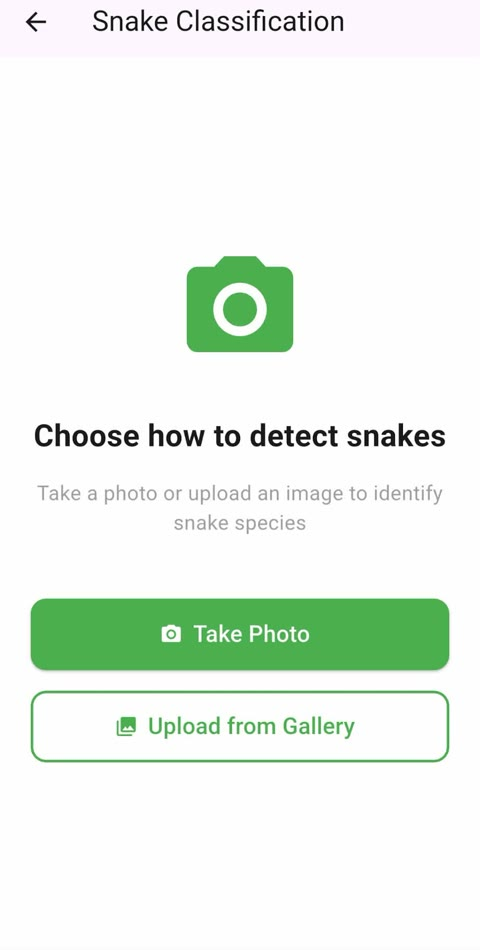
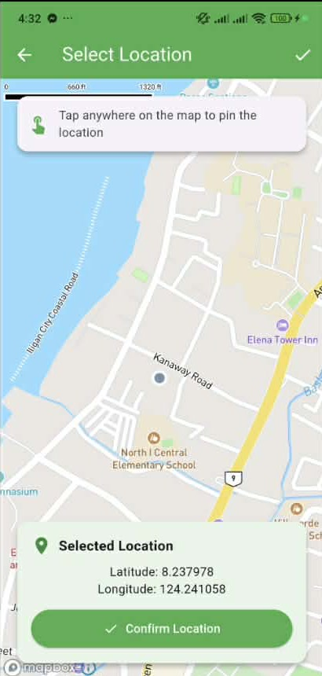

<div align="center">

# SnakeAI: An AI-Based Snake Classification and Anti-Venom Locator System for Public Safety and Conservation

**Snap a snake. Know if it's dangerous. Find anti-venom fast.**

AI-powered snake identification and anti-venom locator for the Philippines


[Demo video](https://drive.google.com/file/d/1yE4gGs6ZT6XtZQQ2YZ_kCCu6VTWZZeLD/view?usp=sharing) · [How it works](#how-it-works) · [Features](#features) · [Presentation](#presented-at-coil-2025) · [Getting started](#getting-started)

</div>

> [!IMPORTANT]
> **Presented internationally** at the **8th Collaborative Online International Learning (COIL) Program**, a joint initiative of **Kyushu Sangyo University (Japan)** and **MSU-Iligan Institute of Technology (Philippines)**, held November 15, 2025.
> Co-presented by Mark Andrey G. Acebu and Janna Joyce E. Jumao-as.

---

## The problem

When someone in the Philippines comes face to face with a snake, two questions matter more than anything else: *is it venomous?* and *where is the nearest anti-venom?* Most people can't answer the first one, and the second often takes calls and searching that waste time.

SnakeAI answers both from a phone camera. It identifies the species on-device, explains how dangerous it is, and points you to the nearest hospital or poison-control unit equipped to help. The same data supports **public safety** and **biodiversity conservation**: every confirmed sighting can be shared to a community map, which helps people see that most snakes are harmless and worth protecting.

## How it works

<div align="center">

**SNAP** &nbsp;→&nbsp; **IDENTIFY** &nbsp;→&nbsp; **ASSESS RISK** &nbsp;→&nbsp; **GET HELP**

</div>

<table>
  <tr>
    <td align="center" width="33%"><br><b>1. Snap</b><br><sub>Frame the snake with the camera, or upload a photo from the gallery.</sub></td>
    <td align="center" width="33%"><br><b>2. Identify and assess</b><br><sub>An on-device YOLO model names the species and shows its venom risk.</sub></td>
    <td align="center" width="33%"><br><b>3. Get help</b><br><sub>Get driving directions to the nearest anti-venom or toxicology unit.</sub></td>
  </tr>
</table>

<div align="center">

**[Watch the full demo video](https://drive.google.com/file/d/1yE4gGs6ZT6XtZQQ2YZ_kCCu6VTWZZeLD/view?usp=sharing)**

</div>

## Features

<details open>
<summary><b>On-device AI snake classification</b></summary>
<br>



- A custom-trained **YOLO** detector exported to **TensorFlow Lite** (`float32`, 640×640 input) runs entirely **on the phone**, so identification still works without signal.
- It recognizes **25 snake species found in the Philippines**, from the Philippine cobra and king cobra to harmless species like the Luzon dwarf snake.
- You can take a photo with the guided camera frame or upload one from the gallery.
- Confidence threshold `0.5` with non-max suppression (IoU `0.45`).

<br clear="right">
</details>

<details>
<summary><b>Venom risk and species encyclopedia</b></summary>
<br>


- Every species has a profile with its common and scientific name, description, geographic range, habitat, and behavior.
- A color-coded **venom toxicity rating** runs from *None* through *Mild*, *Moderate*, and *Extreme*, with the venom type (for example neurotoxic).
- A **safety awareness guide** covers signs and symptoms of envenomation and what to do (and not do) after a bite.

<br clear="right">
</details>

<details>
<summary><b>Anti-venom hospital finder</b></summary>
<br>


- A **Mapbox** map of **14 hospitals and poison-control units** across Luzon, Visayas, and Mindanao, each with its unit name, address, and contact numbers.
- One tap gives **driving directions** with distance and ETA from your current location (Mapbox Directions API).
- You can search any location in the Philippines.

<br clear="right">
</details>

<details>
<summary><b>Community sighting reports</b></summary>
<br>


- You can share a classified sighting to the community map with a pinned location, a description, and up to 5 extra photos.
- Each report shows the species, a *Safe* or *Venomous* tag, the model's confidence, coordinates, and the date.
- Reports are stored in **Cloud Firestore**, and nearby sightings are found with a Haversine distance filter.

<table><tr>
<td align="center"><br><sub>Pin the location</sub></td>
<td align="center"><br><sub>Share with photos</sub></td>
</tr></table>

<br clear="right">
</details>

<details>
<summary><b>Accounts and classification history</b></summary>
<br>

- **Google Sign-In** through Firebase Authentication.
- Every classification is saved locally in **SQLite** so your history is available offline, then synced to Firestore under your account.

</details>

## Presented at COIL 2025

SnakeAI was co-presented at the **8th Collaborative Online International Learning (COIL) Program** between **Kyushu Sangyo University**, Fukuoka, Japan, and **MSU-Iligan Institute of Technology**, Iligan City, Philippines, on **November 15, 2025**. The research proposes an AI-driven system for snake species classification and anti-venom sourcing to support public safety and biodiversity conservation.

<table>
  <tr>
    <td align="center" width="50%"></td>
    <td align="center" width="50%"></td>
  </tr>
</table>

<details>
<summary><b>Certificate of Appreciation</b></summary>
<br>
<div align="center">

</div>
</details>

## Tech stack

| Layer | Technology |
| --- | --- |
| App | Flutter (Dart 3.9), Material 3 |
| State and navigation | `flutter_bloc`, `go_router` with typed routes |
| Dependency injection | `get_it` + `injectable` |
| AI model | YOLO → TensorFlow Lite via `tflite_flutter`, trained on a Roboflow dataset |
| Camera and images | `camera`, `image_picker`, `image` |
| Maps and location | `mapbox_maps_flutter`, Mapbox Directions API, `geolocator` |
| Backend | Firebase Auth (Google Sign-In), Cloud Firestore, Firebase Storage |
| Local storage | `sqflite`, `shared_preferences` |

## Getting started

**Prerequisites:** Flutter SDK (Dart ≥ 3.9), Android Studio or Xcode, and a physical device (recommended for the camera).

```bash
git clone https://github.com/andreypUP/snake_ai_app.git
cd snake_ai_app
flutter pub get
dart run build_runner build --delete-conflicting-outputs   # routes, DI, JSON models
flutter run
```

> [!NOTE]
> To use **your own** Firebase project, run `flutterfire configure`. To use your own Mapbox account, replace the public token in `lib/core/constants/mapbox_constants.dart`.

## Project structure

```text
lib/
├── core/                 # DI container, constants, network checks
├── data/datasources/     # Species info, hospitals, safety guide (JSON)
├── domain/
│   ├── models/           # TFLite model + labels, report/hospital/classification models
│   └── services/         # YOLO detector, auth, Mapbox, reports, sync
├── presentation/
│   ├── pages/            # Camera, results, map, reports, species, profile
│   └── widgets/
└── routes.dart           # Typed go_router routes
```

## Team

| | |
| --- | --- |
| **Mark Andrey G. Acebu** | Developer and co-presenter. College of Engineering, MSU-IIT |
| **Janna Joyce E. Jumao-as** | Co-presenter. College of Engineering, MSU-IIT |

## Acknowledgments

- **Kyushu Sangyo University** and **MSU-Iligan Institute of Technology** for the COIL Program
- **ICpEP.SE MSU-IIT** (Institute of Computer Engineers of the Philippines, Student Edition)
- Snake image dataset via [Roboflow Universe](https://universe.roboflow.com/)

<div align="center">
<sub>Built in the Philippines for public safety and snake conservation.</sub>
</div>
