<div align="center">

# SnakeAI: An AI-Based Snake Classification and Anti-Venom Locator System for Public Safety and Conservation


<br/>


**An AI-powered snake identification and anti-venom locator for the Philippines.** Point your phone at a snake, learn whether it's dangerous, and get directions to the nearest hospital that can help.

[**Demo video**](https://drive.google.com/file/d/1yE4gGs6ZT6XtZQQ2YZ_kCCu6VTWZZeLD/view?usp=sharing) · [**The app**](#the-app) · [**How it works**](#how-it-works) · [**Architecture**](#system-architecture) · [**Under the hood**](#under-the-hood) · [**COIL 2025**](#presented-at-coil-2025) · [**Run it**](#run-it-yourself)

</div>

> [!IMPORTANT]
> **Presented internationally** at the **8th Collaborative Online International Learning (COIL) Program**, a joint initiative of **Kyushu Sangyo University (Japan)** and **MSU-Iligan Institute of Technology (Philippines)**, held November 15, 2025. Co-presented by Mark Andrey G. Acebu and Janna Joyce E. Jumao-as.

<br/>

<table>
  <tr>
    <td width="38%" align="center">
      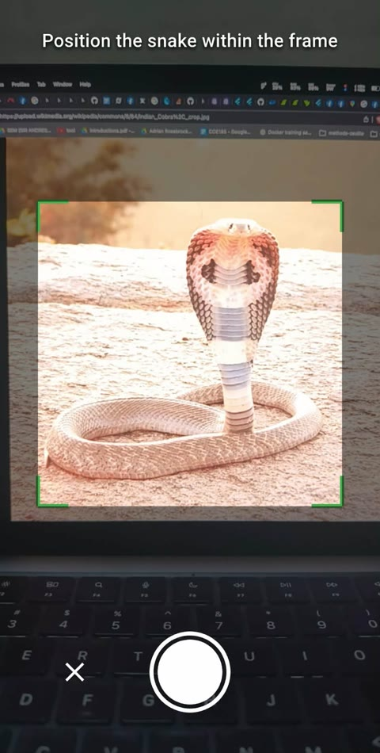
    </td>
    <td width="62%">

### Two questions, answered in seconds

When someone in the Philippines comes face to face with a snake, two questions matter most: **is it venomous?** and **where is the nearest anti-venom?**

SnakeAI answers both from a phone camera. A YOLO model running **on the device** identifies **25 Philippine species** with no internet needed, shows how dangerous the snake is and what to do, then routes you to the nearest of **14 poison-control units**.

Every sighting can also be shared to a **community map**. It helps neighbors stay alert, and it shows that most snakes are harmless and worth protecting.

  </td>
  </tr>
</table>

## The app

<table>
  <tr>
    <td align="center" width="33%"><a href="docs/images/snake_details_sample.jpg">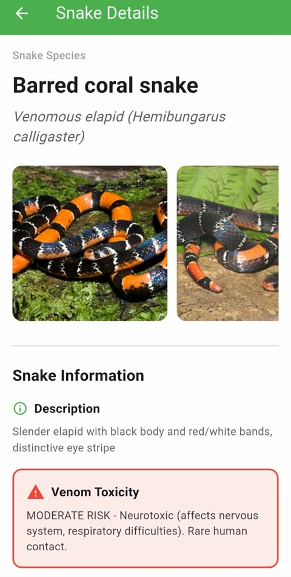</a></td>
    <td align="center" width="33%"><a href="docs/images/snake_classes.jpg">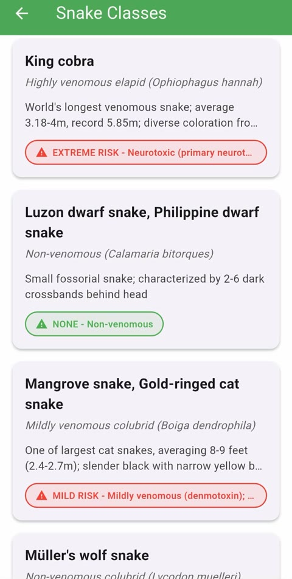</a></td>
    <td align="center" width="33%"><a href="docs/images/map_hospitals.jpg">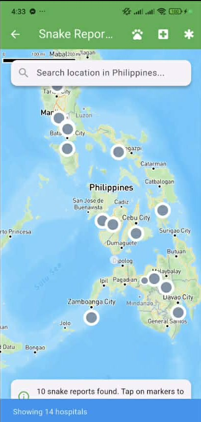</a></td>
  </tr>
  <tr>
    <td align="center"><b>Identify</b><br/><sub>Species, scientific name and venom toxicity</sub></td>
    <td align="center"><b>Encyclopedia</b><br/><sub>Every species with a color-coded risk level</sub></td>
    <td align="center"><b>Hospitals</b><br/><sub>14 poison-control units nationwide</sub></td>
  </tr>
  <tr>
    <td align="center"><a href="docs/images/map_route.jpg">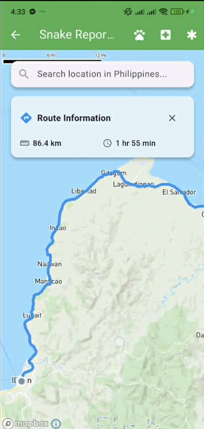</a></td>
    <td align="center"><a href="docs/images/community_reports.jpg">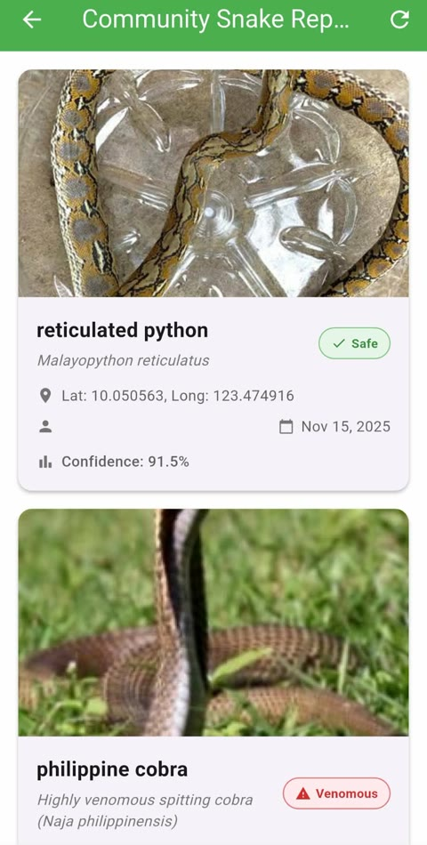</a></td>
    <td align="center"><a href="docs/images/share_report.jpg">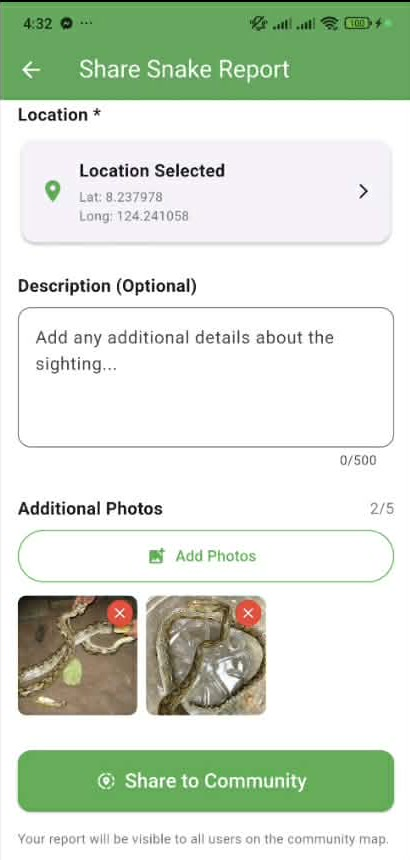</a></td>
  </tr>
  <tr>
    <td align="center"><b>Route</b><br/><sub>Driving directions with distance and ETA</sub></td>
    <td align="center"><b>Community</b><br/><sub>Sightings with a Safe or Venomous tag and confidence</sub></td>
    <td align="center"><b>Share</b><br/><sub>Pin the spot, describe it, add up to 5 photos</sub></td>
  </tr>
</table>

<sub>Click any screenshot to open it full size. Prefer motion? <a href="https://drive.google.com/file/d/1yE4gGs6ZT6XtZQQ2YZ_kCCu6VTWZZeLD/view?usp=sharing"><b>Watch the demo video</b></a>.</sub>

| Feature | What it does |
|---|---|
| **On-device identification** | A YOLO model (TensorFlow Lite, 640×640 input) recognizes 25 Philippine species right on the phone. It works with no signal. |
| **Venom risk at a glance** | Each species is rated None, Mild, Moderate, or Extreme, with its venom type, behavior, habitat, and range. |
| **First-aid guide** | Signs and symptoms of envenomation, what to do, and what *not* to do after a bite. |
| **Anti-venom finder** | A Mapbox map of 14 hospitals and poison-control units. One tap finds the nearest one and draws the route. |
| **Community map** | Share a sighting with its location, a description, and photos. Everyone sees it on the shared map and feed. |
| **History that survives offline** | Every classification is saved to SQLite on the phone, then synced to your account when you're back online. |
| **Google Sign-In** | One-tap sign-in through Firebase Authentication. |

## How it works


## System architecture

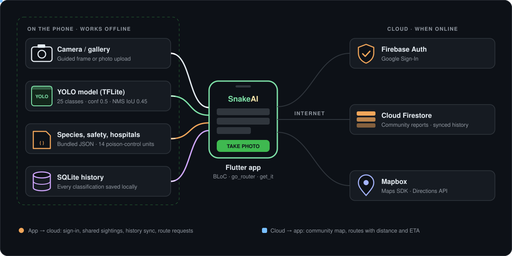

Everything needed to **identify a snake and decide what to do** lives on the phone: the model, the species profiles, the first-aid guide, and the hospital list. A bite can happen far from any signal, so the critical path never waits on the network. The cloud is used only for things that need other people or live data: signing in, the community map, syncing your history, and driving directions.

## Under the hood

Click a section to expand it.

<details>
<summary><b>What happens when you take a photo</b></summary>
<br/>

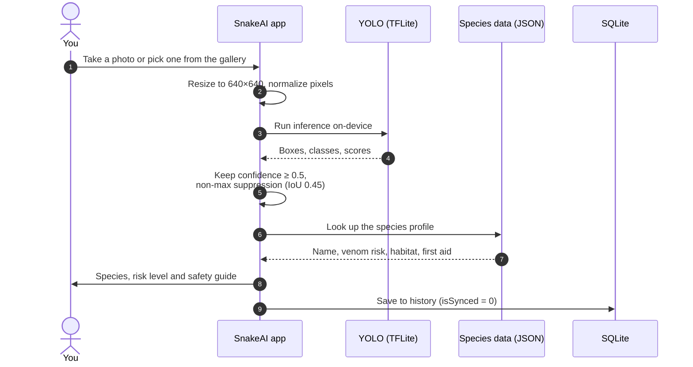

</details>

<details>
<summary><b>Finding the nearest anti-venom</b></summary>
<br/>

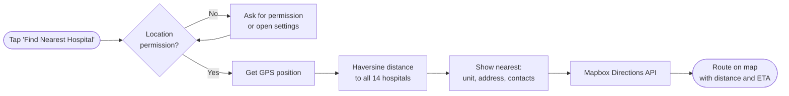

</details>

<details>
<summary><b>Sharing a sighting with the community</b></summary>
<br/>

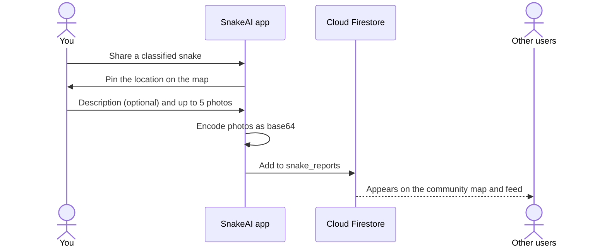

</details>

<details>
<summary><b>Offline history and sync</b></summary>
<br/>

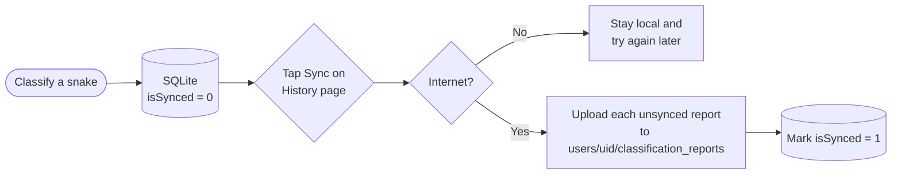

</details>

<details>
<summary><b>The 25 species it recognizes</b></summary>
<br/>

| Risk | Species |
|---|---|
| **Extreme** | King cobra · Philippine cobra · Philippine pit viper |
| **Moderate** | Barred coral snake · North Philippine temple pit viper |
| **Mild** | Boie's keelback · Dog-toothed cat snake · Mangrove cat snake · Paradise tree snake · Philippine blunt-headed cat snake · Philippine cat snake · Philippine whip snake |
| **None** | Gervais' worm snake · Günther's Philippine shrub snake · Luzon bronzeback treesnake · Luzon dwarf snake · Müller's wolf snake · Northern short-headed snake · Philippine bronzeback treesnake · Philippine stripe-lipped snake · Red-tailed green rat snake · Reddish rat snake · Reinhardt's lined snake · Reticulated python · Smooth-scaled mountain rat snake |

More than half of these are harmless. Knowing which one you're looking at keeps people safe **and** keeps harmless snakes from being killed out of fear.

</details>

<details>
<summary><b>Data layout</b></summary>
<br/>

```text
Cloud Firestore
├── snake_reports/<id>                          community sightings
│     { snakeName, scientificName, isVenomous, venomToxicity, confidence,
│       latitude, longitude, description, imageBase64List, userName, createdAt }
└── users/<uid>/classification_reports/<id>     your synced history

On the phone
├── SQLite: classification_reports              offline history (isSynced, syncedAt)
├── lib/domain/models/best_float32.tflite       YOLO weights + labels.txt
└── lib/data/datasources/*.json                 species profiles, first aid
    assets/data/hospitals.json                  14 hospitals
```

</details>

## Presented at COIL 2025

SnakeAI was co-presented at the **8th Collaborative Online International Learning (COIL) Program** between **Kyushu Sangyo University** (Fukuoka, Japan) and **MSU-Iligan Institute of Technology** (Iligan City, Philippines) on **November 15, 2025**. The research proposes an AI-driven system for snake species classification and anti-venom sourcing to support public safety and biodiversity conservation.

<table>
  <tr>
    <td align="center" width="50%">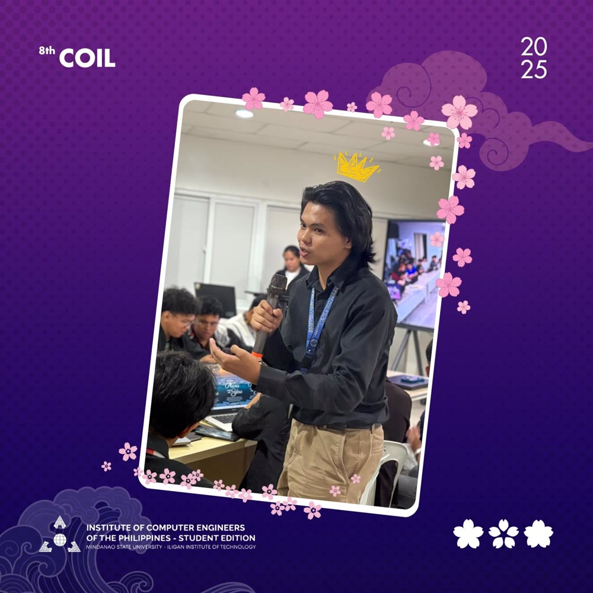</td>
    <td align="center" width="50%">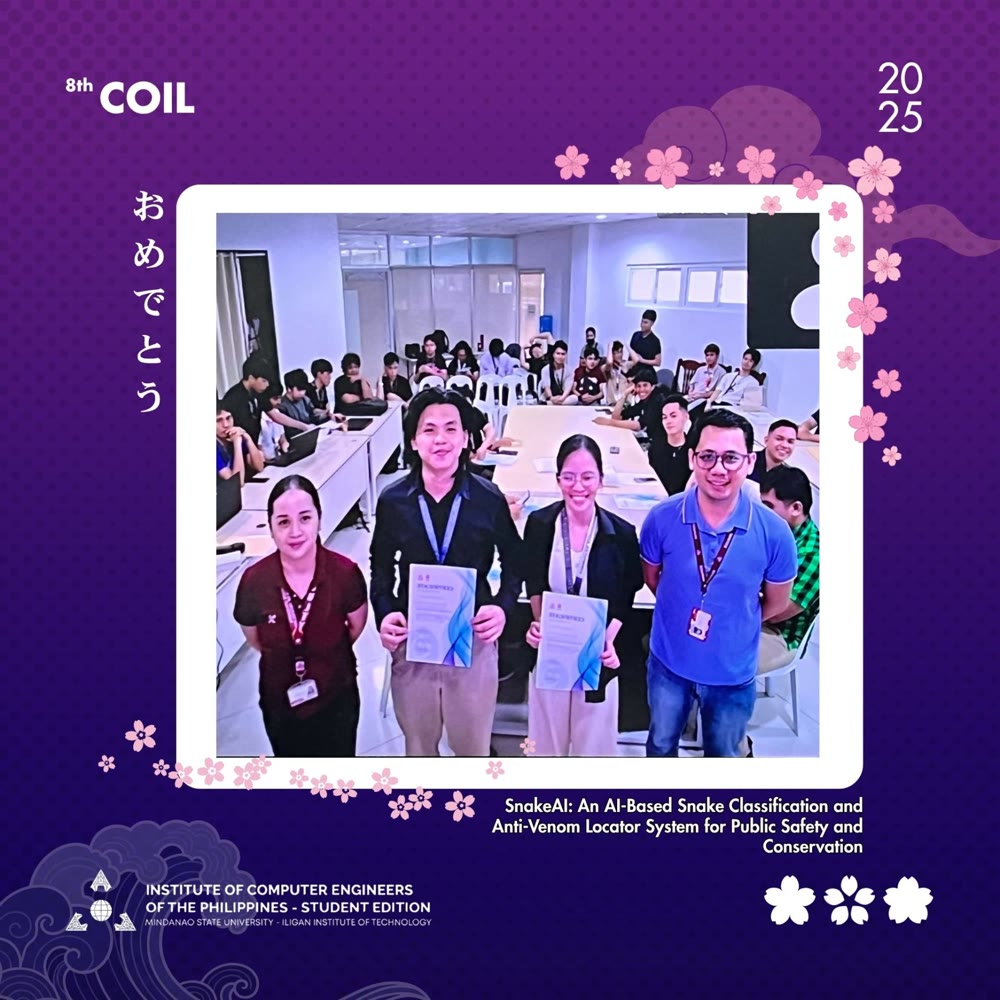</td>
  </tr>
  <tr>
    <td align="center"><sub><b>Presenting SnakeAI</b></sub></td>
    <td align="center"><sub><b>Receiving the certificates</b></sub></td>
  </tr>
</table>

<details>
<summary><b>Certificate of Appreciation</b></summary>
<br/>
<div align="center">
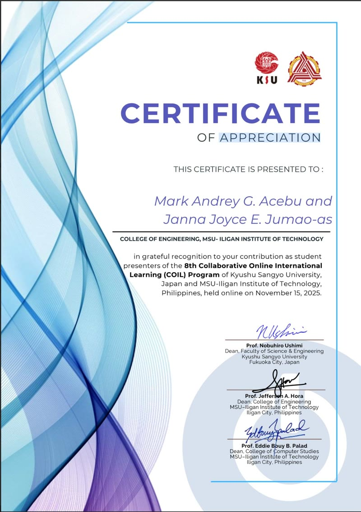
</div>
</details>

## Tech stack

| Layer | Tools |
|---|---|
| App | Flutter (Material 3), Dart `^3.9.2` |
| Architecture | `flutter_bloc`, `go_router` (typed routes), `get_it` + `injectable` |
| AI | YOLO exported to TensorFlow Lite, run with `tflite_flutter`; dataset from Roboflow |
| Camera | `camera`, `image_picker`, `image` |
| Maps | `mapbox_maps_flutter`, Mapbox Directions API, `geolocator` |
| Backend | Firebase Authentication (Google Sign-In), Cloud Firestore |
| Local storage | `sqflite`, `shared_preferences` |

<details>
<summary><b>Project structure</b></summary>
<br/>

```text
lib/
├── core/                 DI container, Mapbox constants, network checks
├── data/datasources/     species profiles, first-aid guide (JSON)
├── domain/
│   ├── models/           TFLite model + labels, report and hospital models
│   └── services/         YOLO detector, auth, hospitals, Mapbox, reports, sync
├── presentation/
│   ├── pages/            camera, results, map, reports, species, profile
│   └── widgets/          safety info
├── routes.dart           typed go_router routes
└── main.dart
assets/data/hospitals.json
docs/
├── diagrams/             animated SVGs used in this README
└── images/               screenshots and COIL photos
```

</details>

## Run it yourself

**You'll need:** the Flutter SDK (Dart `^3.9.2`), Android Studio or Xcode, and a physical phone for the camera.

```bash
git clone https://github.com/andreypUP/snake_ai_app.git
cd snake_ai_app
flutter pub get

# generate routes, dependency injection and JSON models
dart run build_runner build --delete-conflicting-outputs

flutter run
```

<details>
<summary><b>Use your own Firebase and Mapbox</b></summary>
<br/>

- **Firebase:** run `flutterfire configure` to regenerate `lib/firebase_options.dart` and `android/app/google-services.json`, then turn on **Google Sign-In** and **Cloud Firestore** in the console.
- **Mapbox:** put your public token (`pk.…`) in `lib/core/constants/mapbox_constants.dart` and `android/app/src/main/AndroidManifest.xml`.

</details>

## Team

| | |
|---|---|
| **Mark Andrey G. Acebu** | Developer and co-presenter · College of Engineering, MSU-IIT |
| **Janna Joyce E. Jumao-as** | Co-presenter · College of Engineering, MSU-IIT |

## Acknowledgments

- **Kyushu Sangyo University** and **MSU-Iligan Institute of Technology** for the COIL Program
- **ICpEP.SE MSU-IIT**, Institute of Computer Engineers of the Philippines, Student Edition
- Snake image dataset via [Roboflow Universe](https://universe.roboflow.com/)

<div align="center">
<br/>
<sub>Built in the Philippines for public safety and snake conservation.</sub>
</div>
